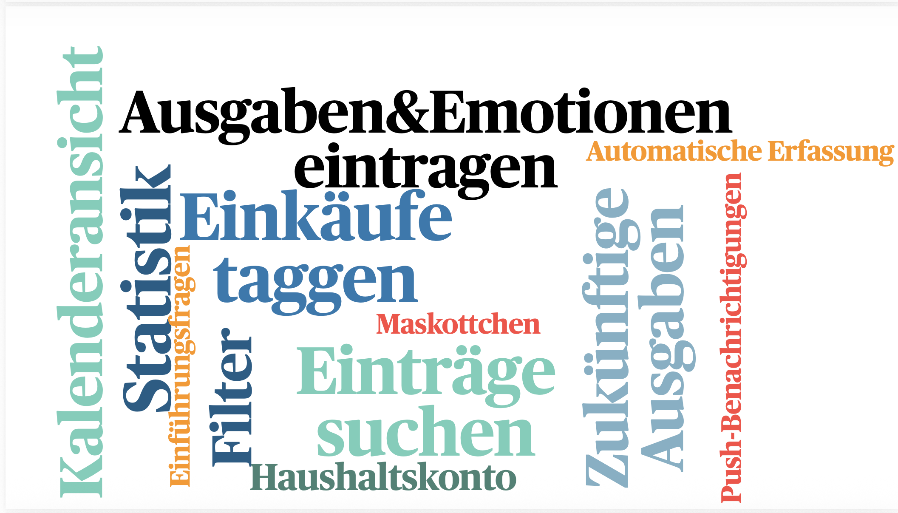
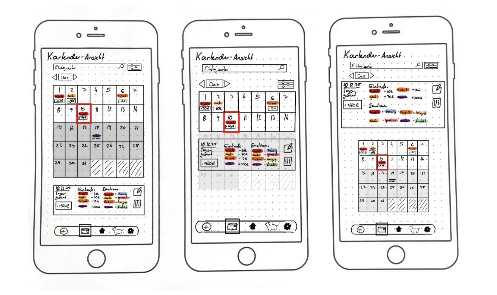

# 💸 Refy — Emotional Financial UX Case Study

Refy is a UX case study exploring emotional and behavioral factors in financial decision-making. Research, personas, and prototypes illustrate a reflection-based financial system to support conscious spending.

_Visual summary of key behavioral concepts and emotional factors influencing spending._

---

## 🔗 Quick Navigation

- [Research](#-research-approach)
- [Concept](#-concept)
- [Prototyping](#-prototyping)
- [Usability Testing](#-usability-findings)
- [Reflection](#-critical-reflection)

## 🧠 UX Case Study

Refy is a user-centered design project exploring how emotions, habits, and digital behavior influence financial decision-making.  
The goal is to design a reflective financial system that helps users understand not only what they spend, but _why_ they spend.

---

## 🔍 Overview

Financial decision-making is often not purely rational.

Users tend to:

- underestimate their spending
- lose awareness through digital payments
- make emotionally driven or impulsive purchases

Refy explores how UX design can support reflection without being restrictive or judgmental.

---

## 📊 Research Approach

The project combines quantitative and qualitative research:

📂 Full research documentation: `research/`

### 📝 Survey

- collected behavioral and demographic data
- used for pattern detection and clustering

### 🎤 Interviews

- explored emotional triggers in spending behavior
- validated survey insights

### 📌 Behavioral Analysis

- identification of structured vs impulsive patterns
- derivation of user stereotypes

---

## 💡 Key Insights

Financial behavior is shaped by:

- emotions (stress, reward, boredom)
- social influence (especially digital media)
- cognitive load (time pressure)
- financial experience

Behavior emerges from context, not logic alone.

---

## 👥 Personas

The personas were derived from survey data, clustering analysis, and validated through follow-up interviews.

### Philip — Impulsive Spender

- emotion-driven decisions
- low financial planning
- social media influence
- low spending awareness

### Christof — Structured Planner

- stable financial routines
- structured budgeting
- low emotional influence
- high financial control

---

## 🎨 Concept

Refy is a reflection-based financial system.  
Instead of only tracking expenses, it supports users in:

- understanding emotional spending patterns
- identifying impulsive behavior
- reflecting on financial decisions
- increasing long-term awareness

---

## 🛠️ Core Features

- Expense tracking with emotional tagging
- Calendar-based financial overview
- Impulse purchase identification
- Behavioral pattern visualization
- Reflection-oriented feedback system

---

## 📱 Prototyping

The concept was translated into a set of low-fidelity paper prototypes covering the application's core interaction flows, including:

- account overview and financial dashboard
- expense input with emotional tagging
- calendar-based spending exploration
- forecasting and analytics
- system feedback and confirmation dialogs

_Prototype highlighting the core calendar interaction and key flows for tracking expenses and emotions._

The design was iteratively refined based on usability feedback, improving clarity and interaction quality.

---

## 🔧 Design Process

- 🧠 Research → `research/`
- 📊 Behavioral analysis & clustering → `research/research_insights.md`
- 👥 Persona development → `concept/personas.md`
- 🎨 Concept & feature design → `concept/features.md`
- 📝 Paper prototyping → `design/prototyping.md`
- 🧪 Usability testing → `process/usability_testing.md`
- 🔄 Iterative refinement → `process/iterations.md`

---

## ✅ Usability Findings

### Strengths

- intuitive calendar interaction
- understandable navigation after onboarding
- emotional tagging well received

### Challenges

- unclear icons and terminology
- forecasting feature needed explanation
- some interaction flows required refinement

---

## 👤 My Contribution

This project was completed as part of a team.

My primary contributions included:

- supporting the planning of user interviews and research activities
- creating paper prototypes and interface concepts
- documenting research findings and design decisions
- helping translate research insights into requirements and features
- advocating for research-driven design decisions throughout the project

---

## 🤔 Critical Reflection

The project revealed that financial applications are not value-neutral.

Features such as emotional tagging and impulse-purchase categorization implicitly promote values like self-reflection, personal responsibility, and behavioral awareness.

Usability testing also challenged our assumptions. We initially expected users to easily connect emotions with spending behavior, but some participants found this difficult. This highlighted how design decisions can unintentionally favor certain users while excluding others.

The project reinforced the importance of questioning embedded assumptions, validating ideas with users, and considering ethical implications alongside usability.

## 🎯 Outcome

Refy demonstrates how UX design can:

- translate behavioral data into design decisions
- integrate emotional context into financial tools
- support reflection instead of optimization

---

## 📄 Final Presentation

Full project overview and visual summary:  
[View Presentation](presentation/Refy_final_presentation.pdf)

---

## ⚠️ Disclaimer

This project was created as part of a Human-Computer Interaction course at Hochschule Darmstadt.  
It represents an exploratory UX case study, not a production application.
